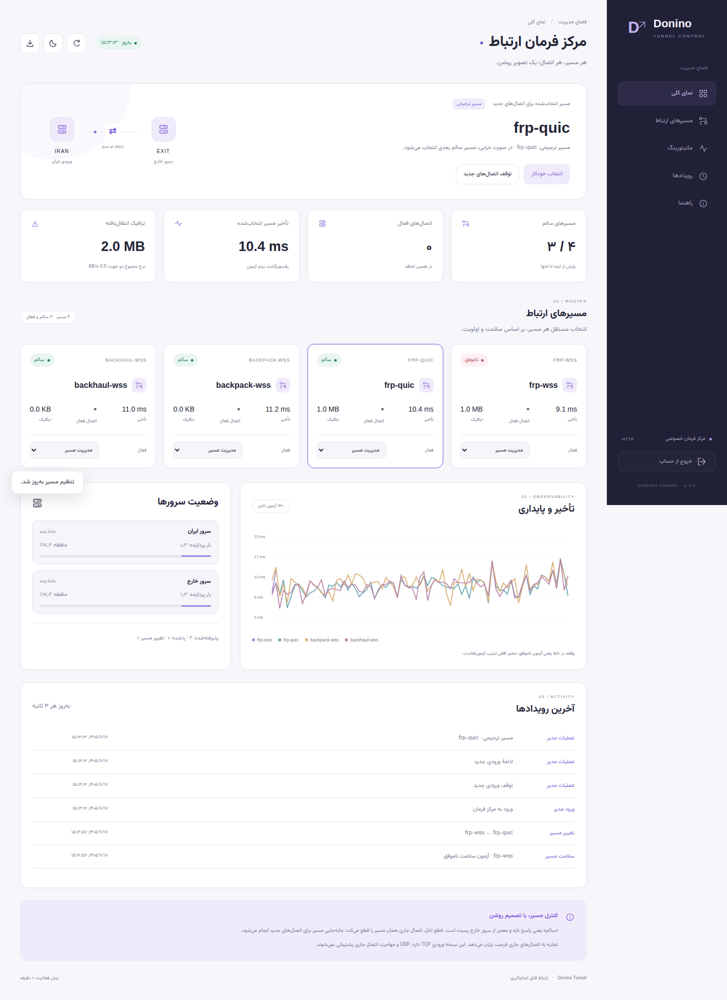

# Donino Tunnel

مرکز مدیریت ارتباط دو سرور، با پنل فارسی، پایش واقعی مسیرها و نصب خودکار. نام بسته و دستور اجرایی `donino-link` است.

**نسخهٔ اولیهٔ قابل آزمایش است؛ تضمینِ غیرقابل تشخیص بودن، بی‌اختلال بودن یا سرعت ثابت ندارد.** آزمون واقعی شبکهٔ ایران و نصب روی VPS هنوز انجام نشده است. دروازهٔ این نسخه TCP است؛ QUIC نام حامل زیرین است و به معنی پشتیبانی از ورودی UDP نیست.

## آنچه ساخته شده

- نصب ترمینالی یکسان روی هر دو سرور با انتخاب نقش، پنل HTTP مستقل ایران و خارج و جفت‌سازی خودکار SSH با کد یک‌بارمصرف؛ [راهنمای شروع](docs/role-setup.md).
- پنل مدرن فارسی RTL، مناسب موبایل، با حالت روشن/تیره و نمودار تأخیر، سلامت دو سرور، شمارندهٔ ترافیک، رویدادهای مدیر، انتخاب ترجیحی، تخلیه و توقف اتصال‌های جدید.
- آزمون سلامت تازه و امضاشده که از خودِ هر تانل عبور می‌کند؛ سلامت سرویس مقصد نیز جداگانه سنجیده می‌شود.
- انتخاب مستقل مسیر و تغییر مسیر اتصال‌های جدید هنگام خرابی. اتصال جاریِ قطع‌شده مهاجرت نمی‌کند و دادهٔ نامطمئن بازپخش نمی‌شود.
- FRP روی WSS با ورودی mTLS و FRP روی QUIC؛ BackPack، Paqet، Backhaul و BrowserLink با انتخاب صریح آزمایشی.
- لایهٔ مشترک انتقال محدود برای حفظ پایان مستقل آپلود/دانلود حتی روی موتورهایی که TCP half-close را نگه نمی‌دارند.
- تولید تنظیمات، کلیدهای مجزا، واحدهای systemd، دانلود نسخه‌های ثابت با SHA256، نصب دو سرور با SSH و بازگشت تنظیمات در صورت شکست.
- **BrowserLink:** مرورگر واقعی Chromium در ایران، صفحهٔ HTTPS روی سرور خارج را باز می‌کند و جریان‌های TCP را با WebSocket بومی همان سایت منتقل می‌کند. [طراحی و محدودیت‌ها](docs/browserlink.md).

## پنل

تصویر زیر از آزمون محلی موتورهای واقعی است؛ اطلاعات شبکهٔ ایران نیست.



[نمای موبایل](docs/evidence/panel-mobile.png) · [حالت تیره](docs/evidence/panel-dark.png) · [صفحهٔ ورود](docs/evidence/panel-login.png)

پنل مستقل خارج نیز روی دو node واقعی systemd آزمایش شده است: [نمای دسکتاپ خارج](docs/evidence/foreign-desktop.png) · [موبایل خارج](docs/evidence/foreign-mobile.png) · [حالت تیره](docs/evidence/foreign-dark.png) · [نبود شاهد تازه پس از لغو دسترسی](docs/evidence/foreign-unknown.png). تصاویر از شبکهٔ خصوصی آزمون هستند.

## راه‌اندازی از داخل پنل

پنل ایران اکنون اتصال SSH خارج، انتخاب هر شش حامل، نقشهٔ نصب، آماده‌سازی هر دو node، فعال‌سازی مرحله‌ای، آزمون تمام مسیرها و بازگشت در شکست را مدیریت می‌کند. کاربر وب محدود است؛ سرویس نصب root جداگانه از socket محلی استفاده می‌کند. [راهنمای نصب از پنل](docs/panel-installer.md) · [تصویر فرم نصب](docs/evidence/iran-setup.png). اجازهٔ SSH با کد پنل خارج خودکار ثبت می‌شود؛ پورت‌های provider باید مجاز باشند. [نصب دو پنل از ترمینال](docs/role-setup.md).

## نصب

کنترل‌کننده: Linux/macOS با Python 3.11+، OpenSSL و SSH. سرورها: Debian 12/13 یا Ubuntu 24.04 با systemd، amd64/arm64. نصب خودکار مسیر مرورگر روی سرور ایران فعلاً Debian 12/13 می‌خواهد؛ نسخهٔ Snap اوبونتو پشتیبانی نمی‌شود.

راه ساده: [فایل مستقل install-donino.sh](install-donino.sh) را دانلود و روی هر دو سرور کپی کن، سپس:

```bash
sudo bash install-donino.sh
```

فقط همین فایل لازم است؛ سورس برنامه همراه آن است. مخزن خصوصی است، بنابراین دانلود را با حساب خودت انجام بده. [راهنمای کامل نصب و ارتقا](docs/role-setup.md).

روش جایگزین با سورس مخزن: با حساب خودت clone کن، سپس:

```bash
git clone https://github.com/danialrad04-sketch/donino-tunnel.git
cd donino-tunnel
sudo bash scripts/setup.sh
```

اسکریپت را **روی هر دو سرور** اجرا کن؛ `1` ایران و `2` خارج. پنل‌ها پیش‌فرض روی HTTP پورت‌های `8090` و `8091` بالا می‌آیند. در خارج کد جفت‌سازی بساز و در ایران وارد کن؛ نصب حامل‌ها از پنل ایران انجام می‌شود. [جزئیات و ارتقا](docs/role-setup.md).

روش جایگزین CLI برای ساخت plan روی کنترل‌کننده:

```bash
python3 -m venv .venv
. .venv/bin/activate
pip install .
donino-link plan --iran 192.0.2.10 --foreign 198.51.100.20 \
  --service app=0.0.0.0:443,127.0.0.1:8443 \
  --transport frp-wss --transport frp-quic --output private-plan
```

IPهای مثال را عوض کن. سرویس اصلی باید روی **loopback سرور خارج، پورت 8443** اجرا شود. رمز پنل تعاملی دریافت می‌شود. کل پوشهٔ plan محرمانه است و نباید commit شود.

ابتدا fingerprint کلید SSH هر دو سرور را از مسیر قابل اعتماد بررسی و در known_hosts ثبت کن. پورت‌های `private-plan/plan.json` را در فایروال میزبان و شرکت میزبان باز کن. نصب‌کننده فایروال عمومی را باز یا پاک نمی‌کند.

```bash
donino-link deploy --plan private-plan --iran-host root@192.0.2.10 \
  --foreign-host root@198.51.100.20 --identity ~/.ssh/id_ed25519 --dry-run
donino-link deploy --plan private-plan --iran-host root@192.0.2.10 \
  --foreign-host root@198.51.100.20 --identity ~/.ssh/id_ed25519
ssh -N -L 8090:127.0.0.1:8090 root@192.0.2.10
```

پنل: `http://127.0.0.1:8090`. دسترسی عمومی با HTTP هم با انتخاب صریح `--http` پشتیبانی می‌شود؛ پیش‌فرض loopback است. [راه‌اندازی پنل آنلاین](docs/online-panel.md). جزئیات نگهداری و خطایابی در [راهنما](docs/operations.md).

برای سه مسیر، با مرورگر واقعی:

```bash
donino-link plan --iran 192.0.2.10 --foreign outside.example.com \
  --service app=0.0.0.0:443,127.0.0.1:8443 \
  --transport frp-wss --transport frp-quic --transport browser-wss \
  --experimental --browser-port 443 --output private-browser-plan
```

در این مثال، دامنهٔ `outside.example.com` متعلق به تو و به سرور خارج اشاره می‌کند. SSH سرور خارج می‌تواند IP همان سرور باشد. مسیر BrowserLink به خارج اتصال می‌زند؛ دو مسیر FRP از خارج به ایران اتصال معکوس دارند. برای BrowserLink سرور ایران حداقل ۲ گیگابایت RAM در نظر بگیر؛ ظرفیت واقعی را با بار کاری خودت اندازه بگیر.

## شواهد و پژوهش

[پژوهش ۲۶ خانوادهٔ روش](docs/research.md) · [طراحی BrowserLink](docs/browserlink.md) · [عملیات](docs/operations.md) · [وضعیت اعتبارسنجی](docs/validation.md)

```bash
python -m unittest discover -s tests -v
python scripts/test-engines.py
python scripts/test-browser.py --chromium /usr/bin/chromium --output browser-results.json
```

آزمون مرورگر باید در محیطی اجرا شود که IPC داخلی Chromium مجاز باشد. آزمون واحد جایگزین آزمون مرورگر واقعی نیست. [GitHub Actions](https://github.com/danialrad04-sketch/donino-tunnel/actions) ماتریس واحد، موتورهای واقعی، مرورگر، رابط پنل و نصب دو node با systemd را اجرا می‌کند.

کد خود پروژه MIT است. موتورهای دانلودشده و فونت مجوز مستقل دارند؛ [مجوزها](docs/research.md#licenses) را ببین.
