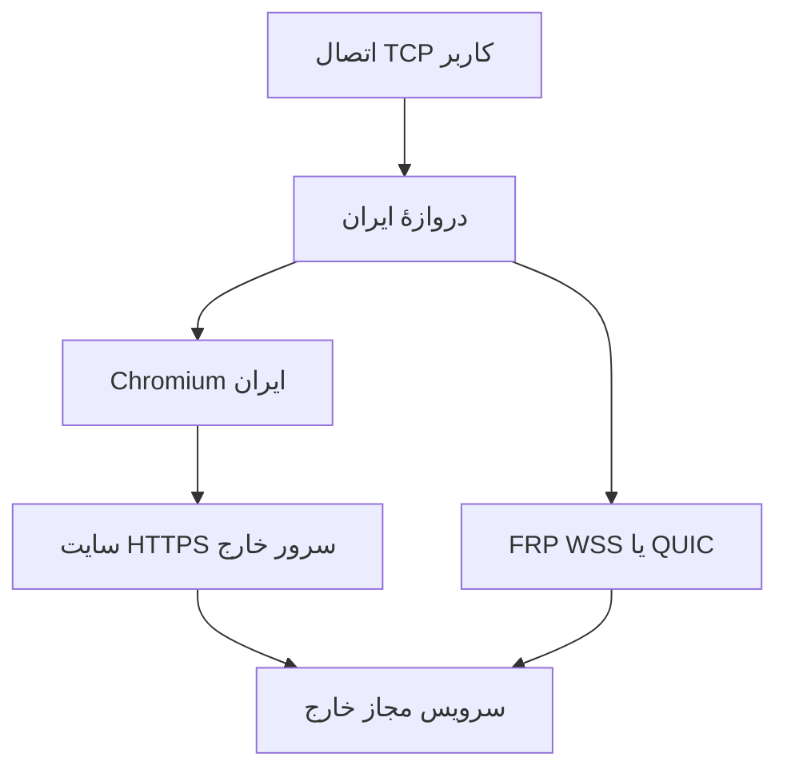

# BrowserLink — هستهٔ انتقال با مرورگر واقعی

## ایدهٔ اصلاح‌شده

باز کردن یک سایت و سپس فرستادن داده با تانل جدا، اثر آن تانل را پاک نمی‌کند. پیاده‌سازی حاضر خودِ داده را از WebSocket بومیِ یک صفحهٔ HTTPS، روی سایت تحت کنترل مالک سرورها عبور می‌دهد. در این مسیر Chromium پشتهٔ TLS و WebSocket سمت ایران را اجرا می‌کند؛ هدرهای جعلی برای تقلید مرورگر تولید نمی‌کنیم.

این ترکیب محصول پروژه است؛ ادعای اختراع اولین تانل مرورگری نداریم. استانداردهای TLS، WebSocket و اجرای مرورگر قبلاً وجود داشته‌اند. جلوگیری از تشخیص، نتیجهٔ قطعی استفاده از مرورگر نیست: IP و دامنه، SNI، طول نشست، حجم آپلود، زمان‌بندی و الگوهای اندازهٔ بسته همچنان اطلاعات می‌دهند. TLS خودِ محتوا را رمز می‌کند، ولی مقصد و همهٔ ویژگی‌های جریان را پنهان نمی‌کند.

## معماری

ایران یک صفحهٔ واقعی و ساده را روی origin خودش باز می‌کند. صفحهٔ عمومی قابل مشاهده است. endpoint خصوصی `/api/stream/{service}` تنها نام سرویس‌های از قبل تعریف‌شده را می‌پذیرد. امکان ارسال مقصد دلخواه از کاربر وجود ندارد. سایت متعلق به مالک طرح است؛ این روش سایت شخص ثالث را relay نمی‌کند.

## احراز هویت و TLS

- راز تصادفی ۲۵۶بیتی در cookie دارای Secure، HttpOnly و SameSite=Strict؛ بدون token در URL.
- بررسی دقیق Origin و فهرست سرویس‌ها؛ درخواست نامعتبر 404، ظرفیت پر 503.
- گواهی سرور خارج با SAN صحیح؛ CA خصوصی آفلاین و گواهی ۹۰روزه در طرح خودکار.
- در حالت CA خصوصی و pin، قبل از هر شروع Chromium، Python زنجیرهٔ CA، نام میزبان و تاریخ گواهی را بررسی می‌کند. برای پذیرش CA خصوصی در Chromium استثنای **محدود به SPKI همان کلید** به کار می‌رود؛ `--ignore-certificate-errors` عمومی وجود ندارد. این بررسی مقدماتی یک نشست TLS کوتاه با اثر انگشت Python ایجاد می‌کند؛ کل ترافیک این حالت صرفاً اثر انگشت مرورگر ندارد.
- برای دامنه با گواهی عمومی معتبر، `ca` و `spki` را از تنظیمات سمت ایران بردار و مسیرهای `cert`/`key` خارج را به گواهی عمومی تنظیم کن. در این حالت TLS کاملاً در مرورگر اعتبارسنجی می‌شود و handshake مقدماتی Python انجام نمی‌گیرد. این تغییر به مدیریت تمدید گواهی عمومی نیاز دارد. سازندهٔ طرح فعلاً ACME خودکار انجام نمی‌دهد.
- CDP از pipeهای خصوصیِ والد/فرزند استفاده می‌کند؛ پورت debugging شبکه باز نمی‌شود. پروفایل مرورگر موقت است، پس از توقف پاک می‌شود. واحد systemd همهٔ فرزندان را متوقف می‌کند.
- Chromium تولیدی با کاربر غیر root و sandbox فعال اجرا می‌شود. گزینهٔ بدون sandbox تنها برای fixture صریح آزمون root با `DONINO_TEST=1` پذیرفته می‌شود؛ plan تولیدی آن را نمی‌نویسد.

## پروتکل انتقال و کنترل جریان

هر TCP stream یک WebSocket مستقل دارد. داده روی اینترنت binary است؛ تبدیل base64 فقط در IPC محلی Python↔Node↔CDP صورت می‌گیرد. این تبدیل مصرف CPU و حافظه دارد و باید در بار واقعی اندازه‌گیری شود.

| نوع بایت اول | معنای frame | شرط |
|---|---|---|
| 0 | داده | ۱ تا ۳۲۷۶۸ بایت payload |
| 1 | پایان نوشتن | بدون payload؛ خواندن جهت مقابل باز می‌ماند |
| 2 | تأیید دریافت دانلود | پس از drain سوکت کاربر |
| 3 | تأیید دریافت آپلود | پس از drain سوکت مقصد |

پنجرهٔ هر جهت ۱۶ frame، یعنی ۵۱۲ KiB در حال ارسال بدون تأیید است. حداکثر ۳۲ stream هم‌زمان در یک process پذیرفته می‌شود. ACK اضافی، frame نامعتبر، مقصد نامعتبر و داده بعد از EOF رد می‌شود. حجم frame، صف Python، صف CDP و bufferedAmount مرورگر محدود است. محدودیتِ پنجره سقف تقریبی throughput را به RTT وابسته می‌کند؛ مثلاً در RTT=100ms سقف نظری پنجره برای هر جریان حدود ۵ MiB/s قبل از هزینه‌های پردازش است. این عدد وعدهٔ سرعت عملی نیست.

کرش مرورگر همهٔ streamهای آن process را قطع می‌کند. بازراه‌اندازی با تأخیر ۱ تا ۳۰ ثانیه و jitter انجام می‌شود؛ بایت‌های قبلی بازپخش نمی‌شوند. آزمون سلامت از همین مرورگر به پاسخ‌دهندهٔ امضاشدهٔ خارج می‌رود. دروازه بعد از رسیدن به آستانهٔ خرابی اتصال‌های جدید را به مسیر سالم دیگر می‌فرستد. handshake مرورگر ممکن است از مهلت اتصال عادی دروازه طولانی‌تر شود؛ آستانه‌های سلامت باید در WAN تنظیم و آزمون شوند.

## محدودیت‌های فعلی و معیار پذیرش

این مسیر آزمایشی، TCP، یک مرورگر و یک سرور خارج است. UDP، جابه‌جایی جریان جاری، pool چند مرورگر، ECH تضمین‌شده، HTTP/3 browser carrier و ACME خودکار پیاده نشده‌اند. TLS سایت توسط aiohttp ختم می‌شود؛ صرف بومی بودن client ادعای مشابهت کامل با یک سایت بزرگ را ثابت نمی‌کند. پورت پیش‌فرض حامل بالا است؛ برای پورت 443 سرور خارج می‌توان carrier-base را تنظیم کرد، به شرط نبود تداخل با سرویس مقصد. تغییر نام سایت یا پورت به تنهایی پنهان‌سازی اثبات‌شده نیست.

قبل از تبدیل شدن به پیش‌فرض باید دو VPS واقعی، ساعت همگام، نام و گواهی معتبر، دسترسی دوطرفه، آزمون ۲۴ تا ۷۲ ساعت و مصرف منابع با ۱/۸/۳۲ جریان هم‌زمان بررسی شوند. upload/download، p50/p95 latency، شکست handshake، packet loss، RSS/CPU مرورگر و بازیابی مسیر ثبت شود. آزمایش استاندارد TLS و ciphertext روی سرورهای خود انجام شود؛ دادهٔ حساس کاربر در capture قرار نگیرد. هیچ نتیجهٔ محلی شاهدِ «غیرقابل تشخیص بودن» نیست.

## منابع پایه

- [RFC 6455 — WebSocket](https://www.rfc-editor.org/rfc/rfc6455)
- [RFC 8446 — TLS 1.3](https://www.rfc-editor.org/rfc/rfc8446)
- [Chromium DevTools Protocol](https://chromedevtools.github.io/devtools-protocol/)
- [Chromium network service](https://chromium.googlesource.com/chromium/src/+/HEAD/services/network/README.md)
