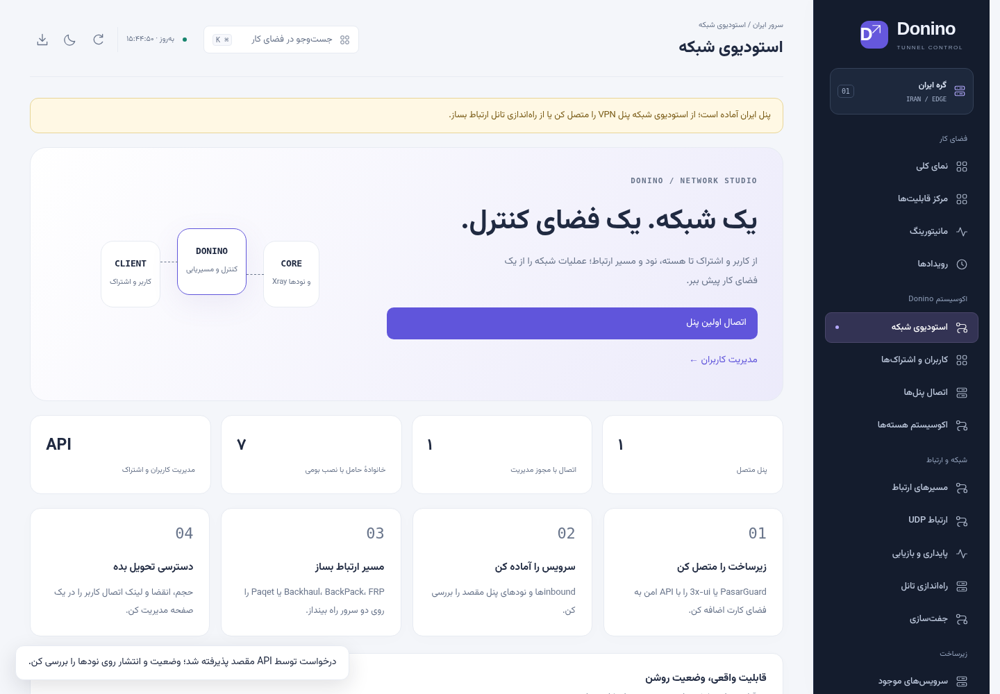
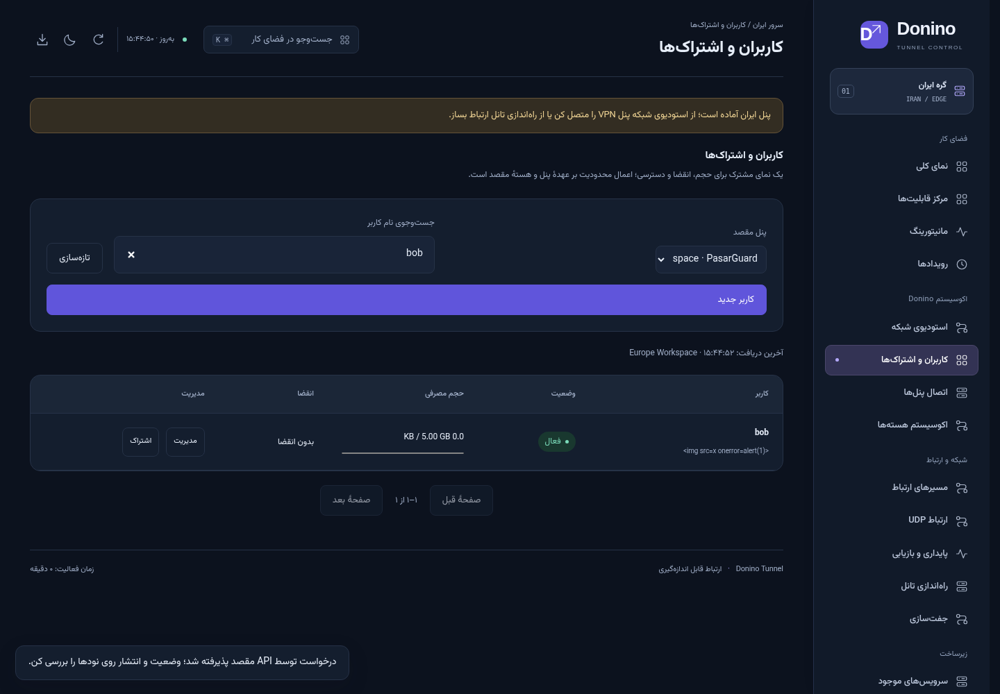

# Donino Network Studio · 0.4.0

این نسخه Donino را از مدیریت تانل به یک فضای کار مشترک برای پنل VPN، کاربران، اشتراک‌ها، هسته و مسیر ارتباط گسترش می‌دهد. رابط مستقل، فارسی و RTL است و به UI یا دیتابیس کپی‌شدهٔ پنل دیگری وابسته نیست. نسخه برای آزمون اپراتور آماده می‌شود؛ آزمون شبکهٔ واقعی ایران/خارج همچنان باید روی سرورهای خودت انجام شود.

## مسیر شروع

1. نصب یا ارتقای Donino روی هر دو سرور و جفت‌سازی طبق [راهنمای مدیریت](management.md).
2. ورود به «استودیوی شبکه ← اتصال پنل‌ها». برای نصب موجود، آدرس **پایه**، نوع API و توکن را ثبت کن؛ مسیر `/panel/api` یا `/api` را به آدرس اضافه نکن. مثلاً `https://panel.example.com/private-path`.
3. اگر backend نداری، از پنل ایران «نصب backend و اتصال به Donino» را انتخاب کن و **سرور خارجِ جفت‌شده** را در فهرست مقصد تعیین کن. نصب و مدیریت از همان کانال HTTPS پین‌شده انجام می‌شود؛ API خود 3x-ui عمومی نمی‌شود. گزینهٔ «همین سرور» برای نصب محلی هم وجود دارد. هر دو عامل Donino باید به نسخهٔ 0.4.0 ارتقا یافته باشند؛ خارج را اول ارتقا بده.
4. در اتصال پنل‌ها، «ساخت inbound امن» را باز کن. یک پورت داخلی مثل `8443` و دامنهٔ سازگار Reality بده، نقشه را بررسی کن و بساز. ورودی VLESS/TCP/Reality به `127.0.0.1` محدود است. دامنه باید از سرور هسته قابل دسترسی و با TLS مقصد سازگار باشد.
5. در «کاربران و اشتراک‌ها»، پنل مقصد را انتخاب کن و کاربر را روی inbound بساز. برای PasarGuard گروه‌ها و proxy settings پیش‌فرض مقصد استفاده می‌شود؛ محتوای اشتراک را قبل از تحویل بررسی کن.
6. در **پنل ایران**، تانل TCP از مثلاً `0.0.0.0:443` به `127.0.0.1:8443` روی خارج بساز. همان سرور خارج باید واقعاً میزبان backend باشد. اتصال‌دادن API یک پنل، به‌تنهایی محل نصب آن را با سرور جفت‌شده یکسان نمی‌کند. در بخش inboundها دکمهٔ «استفاده در تانل» یک ردیف به فرم اضافه می‌کند؛ ردیف‌ها و پورت‌های تکراری را قبل از پیش‌نمایش بررسی کن.
7. در پنجرهٔ اشتراک 3x-ui می‌توان IP/دامنه و پورت **ورودی عمومی ایران** را برای لینک تحویلی تعیین کرد. UUID و تنظیمات Reality حفظ می‌شوند. خروجی VLESS، VMess و Trojan قابل نگاشت است. چند پورت متفاوت را نمی‌توان به یک پورت واحد تبدیل کرد؛ برای این حالت hostها را در پنل مقصد تنظیم کن. این قابلیت، تانل یا فایروال را خودش نصب نمی‌کند.
8. اتصال واقعی کلاینت، حجم، انقضا و بازیابی پس از قطع حامل را روی دو VPS آزمایش کن.

## اتصال‌های پشتیبانی‌شده

| اتصال | احراز هویت | قابلیت این نسخه | شاهد |
| --- | --- | --- | --- |
| 3x-ui v3.10.2 | توکن Bearer | فهرست/جست‌وجوی کاربران، ساخت روی یک inbound، حجم و انقضا، فعال/غیرفعال، reset، لینک، ساخت VLESS/Reality، فهرست inbound | باینری واقعی و Xray واقعی؛ TCP echo و اعمال غیرفعال‌سازی |
| 3x-ui قدیمی؛ قرارداد v2.8.11 | نام و رمز مدیر؛ نشست فقط سمت سرور | کاربران هر inbound، ساخت VLESS/VMess/Trojan، حجم و انقضا، فعال‌سازی و reset؛ لینک اشتراک از پنل اصلی | آزمون قرارداد با fixture؛ آزمون نصب واقعی این نسخهٔ قدیمی انجام نشده |
| PasarGuard v5.4.1 | Access Token (Bearer) یا API Key | کاربران، حجم، انقضا، وضعیت، reset، URL اشتراک، مشاهدهٔ inboundها و نودها | بررسی کد API همان tag و آزمون قرارداد؛ استقرار کامل PasarGuard در این محیط اجرا نشده |

مجوز نوشتن هنگام ثبت اتصال جدا انتخاب می‌شود. پیش‌فرض فقط مشاهده است. برای تغییر نوع توکن یا دسترسی، اتصال را حذف و دوباره ثبت کن؛ حذف اتصال هیچ کاربر یا سرویس upstream را حذف نمی‌کند. ثبت اتصال با یک خواندن واقعی API تأیید می‌شود؛ این وضعیت، گواه سلامت دائمی هسته یا تانل نیست.

نسخهٔ جدید 3x-ui در پاسخ خواندن `id` عددی و `uuid` جدا دارد، ولی در نوشتن `id` باید UUID باشد. آداپتر این تبدیل را انجام می‌دهد. هنگام تغییر، تنظیمات تازه از مقصد خوانده و با revision نمایش‌داده‌شده مقایسه می‌شود. تغییرات خارج از Donino باعث رد ویرایش قدیمی می‌شود. API upstream تراکنش مشترک یا compare-and-swap ندارد؛ ویرایش هم‌زمان از پنل‌های مختلف همچنان باید کنترل شود. عملیات نوشتنِ بی‌پاسخ خودکار تکرار نمی‌شود؛ ابتدا وضعیت مقصد را بررسی کن.

## backend مستقل شامل Xray

نصب از پنل ایران می‌تواند سرور خارجِ جفت‌شده را هدف بگیرد. توکن vendor در رسید root خارج می‌ماند و به پنل ایران یا مرورگر ارسال نمی‌شود؛ اتصال مرکزی فقط شناسهٔ profile جفت‌شده را ذخیره می‌کند. عامل ایران درخواست‌های حساب/inbound مشخص را از Unix socket به عامل خارج می‌فرستد. مسیرهایی مثل دانلود دیتابیس، ارتقای باینری و API مدیریتی دلخواه در این bridge مجاز نیستند. احراز هویت، تطبیق IP منبع و pin گواهی همان جفت‌سازی موجود اعمال می‌شود؛ با لغو جفت‌سازی، دسترسی مرکزی backend هم قطع می‌شود.

نصب تازه، توزیع اصلی **3x-ui v3.10.2** را با SHA256 ثابت دانلود می‌کند، فایل‌های مشخص را بدون اجرای installer upstream استخراج می‌کند و Xray همراه آن را به کار می‌گیرد. خود Donino پیاده‌سازی دوبارهٔ هستهٔ Xray یا دیتابیس آن نیست.

- سرویس: `donino-vpn-backend.service`، حساب مستقل: `donino-vpn`.
- باینری پنل و مجوز: `/opt/donino-vpn-backend/`.
- دیتابیس، باینری هسته، تنظیمات و لاگ backend: `/var/lib/donino-vpn-backend/`.
- رسید و اطلاعات اولیهٔ مدیر فقط برای root: `/var/lib/donino-vpn-private/`.
- API پنل: `127.0.0.1:20539` با مسیر تصادفی؛ API هسته: `127.0.0.1:20541`.
- سرویس اشتراک عمومی upstream در نصب تازه خاموش است؛ لینک‌ها از رابط احراز هویت‌شدهٔ Donino دریافت می‌شوند.
- حداقل ۵۱۲ MiB فضای آزاد، Linux/systemd، عامل root فعال و معماری amd64 یا arm64 لازم است. نصب systemd در CI روی amd64 بررسی می‌شود؛ arm64 بسته و checksum ثابت دارد ولی آزمون اجرا در این محیط ندارد.
- سرویس با `ProtectSystem=strict`، `ProtectHome=true` و `NoNewPrivileges=true` اجرا می‌شود؛ نوشتن محدود به دادهٔ خودش است. capability اتصال به پورت‌های پایین برای هسته مجاز است.
- هیچ `x-ui.service` یا دیتابیس PasarGuard موجودی باز یا مهاجرت داده نمی‌شود. به‌روزرسانی Donino این backend مستقل را حذف یا ارتقا نمی‌دهد. ارتقای خودکار backend در این نسخه اضافه نشده است.

نصب موفق رسید پایدار دارد؛ تکرار درخواست همان توکن را برمی‌گرداند و توکن جدید تولید نمی‌کند. در شکست راه‌اندازی، سرویس تازه متوقف می‌شود و فایل‌ها برای بازیابی می‌مانند. اگر worker بین ایجاد فایل‌ها و ثبت رسید قطع شود، نصب بعدی از بازنویسی وضعیت نیمه‌تمام خودداری می‌کند. وضعیت را با `systemctl status donino-vpn-backend.service` و `journalctl -u donino-vpn-backend.service` بررسی کن. قبل از بازیابی یا پاک‌سازی، از **هر دو** مسیر داده و رسید root نسخهٔ پشتیبان بگیر؛ حذف کورکورانهٔ پوشه‌ها توصیهٔ بازیابی نیست. اطلاعات اولیه در فایل خصوصی `admin.json` است و نباید در issue یا گزارش آزمون ارسال شود.

## مرزهای این نسخه

| خانواده | سطح پشتیبانی |
| --- | --- |
| FRP WSS/QUIC | نصب و هماهنگی دو سرور، آزمون واقعی، انتخاب مسیر و UDP relay |
| BackPack، Backhaul، Paqet | نصب و کنترل بومی؛ نسخه‌های آزمایشی و محدودیت‌های هر موتور طبق [پژوهش](research.md) |
| BrowserLink، Donino Mux، Continuum | حامل‌های Donino؛ محدودیت‌های مرورگر و بازیابی طبق راهنمای موجود؛ آزمایشی |
| Xray | backend مستقل از طریق 3x-ui یا مدیریت پنل موجود با API |
| WireGuard | نگاشت UDP و نصب موجود؛ حساب‌های PasarGuard از API آن مدیریت می‌شوند؛ installer مستقل WireGuard اضافه نشده |
| sing-box، Rathole، GOST، Chisel | شناسایی و کنترل نصب موجود مطابق آداپتر inventory؛ نصب خودکار تازه ندارند |
| Hysteria 2، TUIC | در کاتالوگ برنامه‌ریزی شده‌اند؛ دکمهٔ نصب یا ادعای تست ندارند |

پنل در حال حاضر یک مدیر Donino دارد. RBAC مستقل Donino، نمایندگی فروش، پرداخت، صدور فاکتور، مهاجرت دیتابیس بین دو vendor، QR، تجمیع چند subscription عمومی، ارتقای اتمی هسته‌ها و نصب خودکار تمام پروژه‌های GitHub پیاده نشده‌اند. امکانات upstream که آداپتر ندارند در خود پنل اصلی باقی می‌مانند. این موارد با نام «قابل استفاده» نمایش داده نمی‌شوند.

## داده و اتصال امن

توکن‌های اتصال مستقیم در `ecosystem-connections.json` کنار `state_db` با mode `0600` ذخیره می‌شوند؛ رمزگذاری در حالت سکون پیاده نشده است. فایل را در backup خصوصی سرور حفظ کن. اتصال‌های backend جفت‌شده فقط reference دارند؛ رازهای جفت‌سازی در storage خصوصی عامل ایران و توکن vendor در رسید خصوصی خارج باقی می‌مانند. این فایل وارد خروجی مشاهده‌ها، رویدادها، localStorage یا پاسخ عمومی اتصال‌ها نمی‌شود. لینک اشتراک فقط با درخواست مشخص مدیر دریافت و پس از بستن پنجره یا خروج از رابط حذف می‌شود؛ خود کلیپ‌بورد سیستم بعد از کپی در اختیار کاربر است.

HTTPS برای پنل remote لازم است. HTTP فقط با IP صریح loopback مجاز است؛ برای HTTPS با گواهی اختصاصی می‌توان SHA256 گواهی را ثبت کرد. redirect مقصد دنبال نمی‌شود. توکن برای آدرس یا مسیر دلخواه درخواست کاربر ارسال نمی‌شود؛ آداپتر مسیرهای API مشخص دارد. حداکثر ۱۶ اتصال، ۴ خواندن upstream هم‌زمان، پاسخ ۸ MiB، صفحهٔ ۱۰۰ کاربر و فهرست ۱۰هزارردیفی 3x-ui مجاز است. 3x-ui نسخه‌های مختلف paging ناسازگار دارد؛ این نسخه فهرست محدودشده را محلی صفحه‌بندی می‌کند و دائماً آن را poll نمی‌کند. برای PasarGuard صفحه‌بندی در API مقصد انجام می‌شود.

Donino backend را بدون تغییر از upstream دریافت می‌کند. مجوز کد خود Donino MIT است. 3x-ui و nodeِ PasarGuard GPL-3.0 و پنل PasarGuard AGPL-3.0 هستند. متن GPL و آدرس source نسخهٔ backend کنار نصب نگه داشته می‌شود. BackPack و Backhaul نیز AGPL-3.0 هستند. [یادداشت منابع و مجوزها](ecosystem-research.md) و LICENSE دقیق نسخه‌ها مرجع استفاده و توزیع‌اند.

## شواهد این تغییر

[آزمون باینری واقعی](evidence/ecosystem-real-tests.json) · [مرورگر با پنل احراز هویت‌شده و vendor fixture](evidence/ecosystem-browser-tests.json). تصاویر زیر از دادهٔ ساختگی آزمون مرورگر هستند، نه آمار VPS یا کاربران واقعی.





[نمای تیره](evidence/ecosystem-studio-dark.png) · [اتصال پنل، موبایل](evidence/ecosystem-providers-mobile.png)

## تکرار آزمون‌ها

```bash
python -m unittest discover -s tests -v
python scripts/test-ecosystem.py --output ecosystem-results.json
DONINO_CHROMIUM=/usr/bin/google-chrome python scripts/test-ecosystem-ui.py
python scripts/build-web.py --check
```

آزمون `test-ecosystem.py` باینری واقعی با checksum ثابت و هستهٔ Xray همراه آن را اجرا می‌کند. listenerها محلی‌اند. فقط در تنظیمات آزمون، دسترسی freedom به یک پورت echo روی loopback مجاز می‌شود؛ تنظیمات تولیدی از این استثنا استفاده نمی‌کند. ساخت Reality با خود Xray اعتبارسنجی می‌شود؛ اتصال Reality از WAN و کیفیت اینترنت واقعی با این آزمون ثابت نمی‌شود.

`scripts/test-vpn-backend.py` فقط روی ماشین **خالی و قابل حذف CI** با root/systemd اجرا می‌شود و محیط آزمون خودش را پاک می‌کند؛ آن را روی VPS تولیدی اجرا نکن. این آزمون نصب واقعی از peer HTTPS با pin، bridge واقعی Unix/HTTPS، جداسازی کاربر، محدودیت listenerها، ساخت حساب و بقای داده پس از restart را بررسی می‌کند. دو نقش در این آزمون روی یک ماشین خالی و با TLS واقعی اجرا می‌شوند؛ جای آزمون WAN را نمی‌گیرد.
